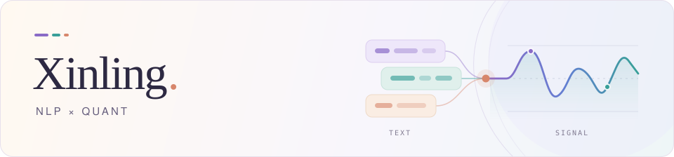

<picture>
  <source media="(prefers-color-scheme: dark)" srcset="assets/header-dark.svg">
  <source media="(prefers-color-scheme: light)" srcset="assets/header-light.svg">
  
</picture>

Master's student in **Computational Linguistics** at **LMU Munich**. Focused on **NLP** and **quantitative research**, with a particular interest in **factor research** and extracting **quantitative signals from unstructured text**.

[Email](mailto:cardyxie@gmail.com) &nbsp;·&nbsp; [All repositories](https://github.com/X1nl1ng-x?tab=repositories)

> **Current focus · SurgAgent** Exploring self-evolving agent harnesses.

### Selected projects

| Project | Focus |
| :--- | :--- |
| **[Transformer from Scratch](https://github.com/X1nl1ng-x/transformer-from-scratch)** NLP · PyTorch | An encoder–decoder Transformer with attention, masking, positional encoding, and a toy copy-task training loop. |
| **[RAG Studium Assistant](https://github.com/X1nl1ng-x/RAG_Studium_Assistant)** NLP · Agentic RAG | An agentic study planner combining handbook retrieval with deterministic degree-rule validation. |
| **[Crypto Factor Research](https://github.com/X1nl1ng-x/crypto-xsec-factor)** Quant · Empirical research | Cross-sectional tests of trading-volume signals in crypto futures, including robustness checks and evaluation on a later sample. |

### Tech stack

`Python` `PyTorch` `Docker` `Ollama` `Qdrant` `n8n`
